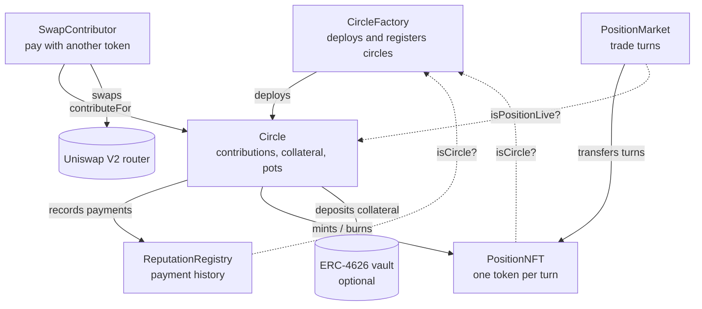
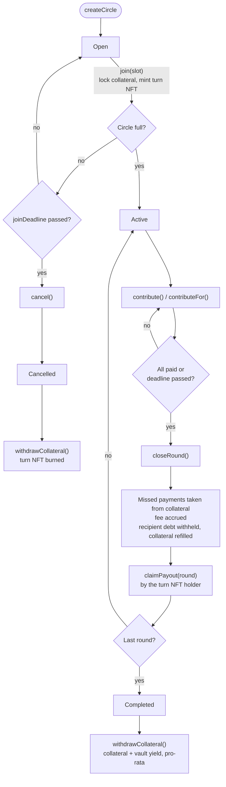
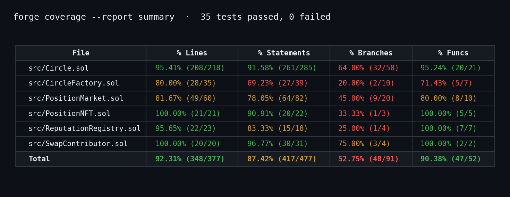

# ROSCA Protocol

## About

ROSCA Protocol brings rotating savings circles on-chain. A group of members pays a fixed stablecoin contribution every round, and each round the whole pot goes to one member. Collateral, debt withholding and an on-chain payment history replace the personal trust that traditional circles depend on.


---

## On-chain Rotating Savings and Credit Associations

### Project Overview

Rotating savings and credit associations (ROSCAs) are used by hundreds of millions of people around the world under many names: *tanda* in Mexico, *junta* or *pandero* in Peru, *consórcio* in Brazil, *chama* in Kenya, *susu* in Ghana, *chit fund* in India and *hui* in China. Every member contributes the same amount each round, and each round one member receives the whole pot. Early recipients get interest-free credit; late recipients get disciplined savings.

Traditional circles have three structural problems:

- **Trust:** a member who collects the pot early can stop paying and disappear.
- **No liquidity:** a member cannot sell or advance their turn.
- **No record:** a reliable member has no way to prove it to a new group.

ROSCA Protocol solves them with smart contracts:

| Problem | On-chain solution |
| --- | --- |
| A member stops paying | Collateral sized per turn covers missed contributions; uncovered debt is withheld from the defaulter's own pot and paid to the rounds that were short |
| Turns cannot be traded | Each turn is an ERC-721 token. Whoever holds it collects that round's pot, and it can be sold on the built-in market |
| Idle collateral | Collateral can sit in an allow-listed ERC-4626 vault and earn yield, shared pro-rata at the end |
| Only one accepted token | Members can pay with any token routed through a Uniswap V2 router |
| No payment history | Every payment, late payment and default is written to a non-transferable reputation registry |

Example used throughout this document: a circle of 4 members (Ana, Luis, Marta and Pedro in turns 0 to 3), a contribution of 100 USDC, a pot of 400 USDC, a 1% protocol fee and 100% collateral coverage.

---

## How It Works

### Smart contracts

| Contract | Role | Holds user funds | Admin |
| --- | --- | --- | --- |
| [`CircleFactory`](src/CircleFactory.sol) | Deploys circles, keeps the registry of legitimate circles, the token and vault allow-lists and the fee for new circles | No | `Ownable2Step` |
| [`Circle`](src/Circle.sol) | One savings circle: joining, contributions, round closing, payouts, defaults, collateral and yield | Yes | None |
| [`PositionNFT`](src/PositionNFT.sol) | One ERC-721 token per turn, with fully on-chain metadata | No | None |
| [`ReputationRegistry`](src/ReputationRegistry.sol) | Payment history of every address across all circles | No | None |
| [`PositionMarket`](src/PositionMarket.sol) | Secondary market to buy and sell turns with stablecoins | Only its fees | `Ownable2Step` |
| [`SwapContributor`](src/SwapContributor.sol) | Pays a contribution with any token through a Uniswap V2 router | No | None |

### Architecture



`CircleFactory.isCircle` is the single source of truth: `PositionNFT` and `ReputationRegistry` only accept calls from contracts the factory deployed.

### Circle life cycle



### Collateral per turn

A member who collects early still owes contributions afterwards, so earlier turns lock more collateral. The requirement is one contribution as a buffer plus `collateralBps` of the contributions still owed after the payout:

```
requiredCollateral(slot) = C + C × (N − 1 − slot) × collateralBps / 10 000
```

| Turn | Collects in round | Owes after collecting | Collateral at 10 000 bps (100%) |
| --- | --- | --- | --- |
| 0 | 0 | 3 contributions | 400 USDC |
| 1 | 1 | 2 contributions | 300 USDC |
| 2 | 2 | 1 contribution | 200 USDC |
| 3 | 3 | 0 contributions | 100 USDC |

Before a member's own payout, their pot acts as collateral: any debt they built up is withheld from it.

### Default example

Pedro (turn 3, 100 USDC of collateral) skips rounds 0 and 1:

| Round | What happens | Net pot | Collected by |
| --- | --- | --- | --- |
| 0 | 100 USDC taken from Pedro's collateral, which drops to 0 | 396 | Ana |
| 1 | No collateral left: Pedro owes 100, round 1 is 100 short | 297 | Luis |
| 2 | Everyone pays | 396 | Marta |
| 3 | 100 of debt withheld from Pedro's pot (credited to Luis) and 100 used to refill his collateral | 196 | Pedro |

Nobody but Pedro loses money, and the circle ends with a zero balance.

---

## Technical Docs

### `Circle.sol`

| Function | Access | Description |
| --- | --- | --- |
| `requiredCollateral(uint32 slot)` | view | Collateral required for a turn |
| `join(uint32 slot)` | any | Takes a free turn, locks its collateral (deposited in the vault if any) and mints the turn NFT. The last member to join starts the circle |
| `cancel()` | any | Cancels an `Open` circle that was not filled before `joinDeadline` |
| `contribute()` | member | Pays the caller's contribution for the current round |
| `contributeFor(address member)` | any | Pays the current round for `member`; funds come from `msg.sender` |
| `closeRound()` | any | Closes the round once everyone paid or the deadline passed: slashes collateral of non-payers, accrues the fee, withholds the recipient's debt, refills their collateral and records the net payout. Opens the next round with a full `roundDuration` window |
| `claimPayout(uint32 round)` | NFT holder | Pays a closed round's pot to the current holder of that turn's NFT and burns the NFT |
| `withdrawClaimable()` | any | Withdraws compensation credited after a short round was already claimed |
| `withdrawCollateral()` | member | After completion or cancellation, returns the remaining collateral plus its pro-rata share of vault yield |
| `withdrawFees()` | any | Sends accrued fees to the factory's `feeRecipient` |
| `rescueERC20(IERC20 token, address to)` | factory owner | Recovers tokens sent by mistake; the circle token and vault shares are protected |
| `positionInfo(uint32 slot)` | view | Token, gross pot, payout, encumbrance (debt and collateral refill to be withheld) and estimated payout time |
| `isPositionLive(uint32 slot)` | view | True while the circle is `Active` or `Completed` and the pot was not claimed |

Internal logic:

| Function | Description |
| --- | --- |
| `_collectDefaults` | Takes each missed contribution from the member's collateral; anything uncovered becomes `debtOf[member]` and `roundShortfall[round]` |
| `_settleRecipient` | Withholds the recipient's debt and refills their collateral before the payout is recorded |
| `_compensate` | Pays withheld debt to earlier short rounds, oldest first: added to the pot if unclaimed, else credited to `claimable` |
| `_settle` | Redeems vault shares and snapshots real and nominal collateral for pro-rata withdrawals |

Configuration (`Circle.Config`, immutable after creation):

| Field | Description |
| --- | --- |
| `token` | Stablecoin for contributions and collateral |
| `contributionAmount` | Amount paid by each member per round |
| `maxMembers` | Number of members and rounds (2 to 50) |
| `roundDuration` | Minimum time to pay each round |
| `joinDeadline` | Deadline for the circle to fill |
| `collateralBps` | Share of post-payout exposure backed by collateral (0 to 10 000) |
| `yieldVault` | Optional ERC-4626 vault whose `asset()` is `token` |

### `CircleFactory.sol`

| Function | Access | Description |
| --- | --- | --- |
| `createCircle(Circle.Config cfg)` | any | Deploys a circle with an allow-listed token and vault; the current `feeBps` is fixed in the circle |
| `setTokenAllowed(address, bool)` | owner | Adds or removes a stablecoin |
| `setVaultAllowed(address, bool)` | owner | Adds or removes an ERC-4626 vault |
| `setFeeBps(uint16)` | owner | Fee for future circles, capped at 200 bps (2%) |
| `setFeeRecipient(address)` | owner | Address that receives protocol fees |
| `isCircle(address)` | view | Whether an address is a circle deployed by the factory |
| `circlesCount()` | view | Number of circles created |

### `PositionNFT.sol`

| Function | Access | Description |
| --- | --- | --- |
| `mint(address to, uint32 slot)` | registered circles | Mints the token for a turn of the calling circle |
| `burn(uint256 tokenId)` | the minting circle | Burns a turn on payout claim or cancellation |
| `tokenURI(uint256 tokenId)` | view | Base64 JSON metadata built on-chain from the circle's live state |
| `positions(uint256 tokenId)` | view | Circle and turn behind a token id |

### `ReputationRegistry.sol`

| Function | Access | Description |
| --- | --- | --- |
| `recordPayment(address, bool onTime)` | registered circles | Counts an on-time or late payment |
| `recordDefault(address, uint256 uncovered)` | registered circles | Counts a default and adds uncovered debt |
| `recordDebtRepaid(address, uint256)` | registered circles | Reduces outstanding debt |
| `recordCompletion(address)` | registered circles | Counts a circle completed without defaults |
| `recordOf(address)` | view | Returns `onTimePayments`, `latePayments`, `defaults`, `circlesCompleted` and `outstandingDebt` |

### `PositionMarket.sol`

| Function | Access | Description |
| --- | --- | --- |
| `list(uint256 tokenId, IERC20 paymentToken, uint256 price)` | token owner | Lists a live turn; the market must be approved and the payment token allow-listed |
| `buy(uint256 tokenId, IERC20 paymentToken, uint256 maxPrice)` | any | Buys a listing; reverts if the listing is stale, the turn was claimed, or the price or token changed |
| `cancel(uint256 tokenId)` | seller, or anyone for a stale listing | Removes a listing |
| `withdrawFees(address token)` | any | Sends accrued fees to `feeRecipient` |
| `setFeeBps(uint16)` | owner | Market fee, capped at 500 bps (5%) |
| `setFeeRecipient(address)` | owner | Address that receives market fees |

### `SwapContributor.sol`

| Function | Access | Description |
| --- | --- | --- |
| `contributeWithSwap(Circle circle, address member, uint256 amountInMax, address[] path, uint256 deadline)` | any | Swaps at most `amountInMax` of `path[0]` into the exact contribution, pays it for `member` and refunds the unused input. The path must end in the circle token, and the router allowance is reset to zero |

### Security design

| Risk | Mitigation |
| --- | --- |
| Reentrancy | `nonReentrant` on every function that moves funds, checks-effects-interactions order, `_mint` instead of `_safeMint` |
| Admin access to user funds | No admin role in `Circle`; `rescueERC20` cannot move the circle token or vault shares |
| Rule changes mid-circle | All configuration and the fee are immutable per circle |
| Collect-and-run defaults | Collateral sized per turn plus debt withheld from the defaulter's own pot |
| Round-closing griefing | The next round always gets a full `roundDuration` window |
| Blocked transfers | Every payout, compensation, collateral release and fee is pulled by its recipient |
| Unbounded loops | At most 50 members per circle |
| Front-running on the market | Buyer passes `maxPrice` and `paymentToken` |
| Ownership loss | `Ownable2Step` on the factory and the market |

---

## Deployment

### Deployment order

`PositionNFT` and `ReputationRegistry` store the factory address as an immutable, and the factory verifies both in its constructor. [`script/Deploy.s.sol`](script/Deploy.s.sol) pre-computes the factory address from the deployer's nonce:

| Step | Contract | Constructor arguments |
| --- | --- | --- |
| 1 | `PositionNFT` | Pre-computed factory address |
| 2 | `ReputationRegistry` | Pre-computed factory address |
| 3 | `CircleFactory` | `OWNER`, `TREASURY`, `FEE_BPS`, `PositionNFT`, `ReputationRegistry` |
| 4 | `PositionMarket` | `OWNER`, `TREASURY`, `MARKET_FEE_BPS`, `CircleFactory`, `PositionNFT` |
| 5 | `SwapContributor` | `V2_ROUTER`, `CircleFactory` |

### Environment variables

| Variable | Required | Default | Description |
| --- | --- | --- | --- |
| `OWNER` | Yes | | Owner of the factory and the market |
| `TREASURY` | Yes | | Recipient of protocol and market fees |
| `V2_ROUTER` | Yes | | Uniswap V2 router on the target network |
| `FEE_BPS` | No | 50 (0.5%) | Fee for new circles |
| `MARKET_FEE_BPS` | No | 250 (2.5%) | Market fee |

### Commands

```bash
cast wallet import deployer --interactive
```

```bash
forge script script/Deploy.s.sol --rpc-url $RPC_URL --account deployer --broadcast --verify
```

After deployment, `OWNER` calls `CircleFactory.setTokenAllowed(<stablecoin>, true)` and, for yield-bearing circles, `setVaultAllowed(<vault>, true)`.

### Deployment gas

Measured with the deployment script on a local Anvil node (chain id 31337):

| Contract | Gas used |
| --- | --- |
| `PositionNFT` | 1,545,635 |
| `ReputationRegistry` | 527,099 |
| `CircleFactory` | 3,795,695 |
| `PositionMarket` | 1,232,151 |
| `SwapContributor` | 671,524 |
| **Total** | **7,772,104** |

### Deployed contracts

| Network | Contract | Address |
| --- | --- | --- |
| — | — | Not yet deployed to a public network |

---

## Tests

35 tests written with Foundry. Shared setup lives in [`test/BaseTest.sol`](test/BaseTest.sol), and [`test/mocks/Mocks.sol`](test/mocks/Mocks.sol) provides a mintable ERC-20, an OpenZeppelin ERC-4626 vault and a fixed-rate Uniswap V2 router.

```bash
forge test
```

### `Circle.t.sol` (23 tests)

| Test | What it checks |
| --- | --- |
| `test_RevertWhen_TokenNotAllowed` | A circle cannot be created with a token outside the allow-list |
| `test_RevertWhen_InvalidConfig` | `collateralBps` above 10 000 is rejected |
| `test_RequiredCollateral_DecreasesBySlot` | Turns require 400, 300, 200 and 100 USDC; at 50% turn 0 requires 250 |
| `test_Join_MintsPositionsAndStarts` | With four members the circle is `Active`, holds 1,000 USDC of collateral and each member owns their turn NFT |
| `test_RevertWhen_SlotTaken` | Two members cannot take the same turn |
| `test_RevertWhen_AlreadyMember` | One address cannot take two turns |
| `test_RevertWhen_JoinAfterDeadline` | Nobody can join after `joinDeadline` |
| `test_FullCycle_AllPay` | Four rounds with full payment: each recipient gets 396 USDC, fees reach the treasury, every member ends 4 USDC down, the circle ends empty and reputation is updated |
| `test_RevertWhen_CloseBeforeDeadline` | A round with missing payments cannot close before its deadline |
| `test_RevertWhen_ContributeTwice` | A member cannot pay the same round twice |
| `test_RevertWhen_ClaimTwiceOrOpenRound` | An open round cannot be claimed, and a pot cannot be claimed twice |
| `test_LateClose_GivesFullWindowToNextRound` | Closing a round 100 days late still gives the next round a full 30-day window |
| `test_Default_CollateralKeepsPotWhole` | A missed payment is taken from collateral and the pot stays at 396 USDC |
| `test_Default_DebtWithheldFromOwnPayoutAndCompensated` | Uncovered debt is withheld from the defaulter's pot, the short round is compensated, collateral is refilled and the circle ends empty |
| `testFuzz_Conservation` | 512 runs with random payments and collateral levels: solvent after every round, no tokens stuck, no tokens created or lost |
| `test_TransferredPosition_MovesPayoutRight` | After an NFT transfer only the new holder can claim the pot |
| `test_TokenURI_IsOnChainJson` | `tokenURI` returns a Base64 JSON data URI |
| `test_RevertWhen_NonCircleMints` | Only registered circles can mint turn NFTs |
| `test_Cancel_ReturnsCollateralAndBurnsPositions` | An unfilled circle can be cancelled, collateral is returned in full and turn NFTs are burned |
| `test_RevertWhen_CancelActiveCircle` | An `Active` circle cannot be cancelled |
| `test_YieldVault_SharesYieldProRata` | Collateral sits in the vault and 10% yield is shared pro-rata |
| `test_RescueERC20_CannotTouchMembersFunds` | The factory owner cannot rescue the circle token but can rescue unrelated tokens |
| `test_FeeIsSnapshottedAtCreation` | A fee change does not affect existing circles, and the fee cap is enforced |

### `PositionMarket.t.sol` (8 tests)

| Test | What it checks |
| --- | --- |
| `test_ListAndBuy` | A 350 USDC sale pays the seller 341.25 USDC and accrues 8.75 USDC of fees, withdrawn to the treasury |
| `test_RevertWhen_ListingIsStale` | A listing whose seller transferred the NFT cannot be bought and can be cleared by anyone |
| `test_RevertWhen_SellerRaisesPriceBeforeBuy` | A price raise before the buy makes it revert through `maxPrice` |
| `test_RevertWhen_ListWithoutApproval` | Listing requires the market to be approved |
| `test_RevertWhen_NotOwnerLists` | Only the owner can list a turn |
| `test_RevertWhen_PositionAlreadyClaimed` | A turn whose pot was claimed cannot be bought |
| `test_RevertWhen_PositionOfOpenCircle` | Turns of a circle that has not started cannot be listed |
| `test_RevertWhen_FeeAboveCap` | The market fee cannot exceed 5% |

### `SwapContributor.t.sol` (4 tests)

| Test | What it checks |
| --- | --- |
| `test_ContributeWithSwap_RefundsLeftover` | Paying with DAI spends 101 of 200 DAI, refunds 99, records the payment and leaves no balance or allowance behind |
| `test_RevertWhen_PathDoesNotEndInCircleToken` | A swap path that does not end in the circle token is rejected |
| `test_RevertWhen_UnknownCircle` | A circle not deployed by the factory is rejected |
| `test_RevertWhen_SlippageTooHigh` | The call reverts when the swap needs more than `amountInMax` |

---

## Test Coverage

```bash
forge coverage --report summary --no-match-coverage "test|script"
```



| Metric | Coverage |
| --- | --- |
| Lines | 92.31% (348/377) |
| Statements | 87.42% (417/477) |
| Branches | 52.75% (48/91) |
| Functions | 90.38% (47/52) |

---

## Tech Stack

| Tool | Version |
| --- | --- |
| Solidity | 0.8.35 |
| Foundry | forge 1.7.1 |
| OpenZeppelin Contracts | 5.7.0 |
| forge-std | 1.16.2 |

## Project Structure

```
ROSCA/
├── src/
│   ├── Circle.sol
│   ├── CircleFactory.sol
│   ├── PositionMarket.sol
│   ├── PositionNFT.sol
│   ├── ReputationRegistry.sol
│   ├── SwapContributor.sol
│   └── interfaces/
│       ├── ICircle.sol
│       ├── ICircleFactory.sol
│       └── IV2Router02.sol
├── test/
│   ├── BaseTest.sol
│   ├── Circle.t.sol
│   ├── PositionMarket.t.sol
│   ├── SwapContributor.t.sol
│   └── mocks/Mocks.sol
├── script/
│   └── Deploy.s.sol
├── docs/
│   ├── guia-tecnica.md
│   └── images/coverage.png
├── foundry.toml
└── README.md
```

## Author

Jose L Imoberdorf · [GitHub](https://github.com/JLImober)

## License

MIT
