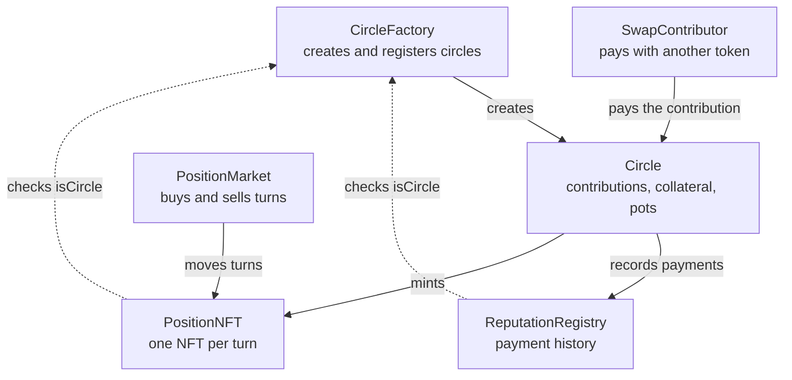

# ROSCA: project technical guide

October 13, 2026

## 1. Overview

ROSCA is a protocol for rotating savings circles (tandas, juntas, panderos, chamas, susus) built with 6 Solidity contracts, 35 Foundry tests and a deployment script. The code lives in `~/ROSCA` and uses OpenZeppelin 5.7 with the 0.8.35 compiler.

A circle works like this:

1. Someone creates a circle: stablecoin, contribution per round, number of members, round duration and collateral level.
2. Each member picks a turn and locks collateral. They receive an NFT that represents the right to collect that turn.
3. Every round, everyone pays the contribution and the holder of that round's NFT collects the pot, minus the fee.
4. If someone does not pay, their contribution is taken from their collateral. Whatever the collateral does not cover is deducted from their own pot when it is their turn to collect.
5. At the end, each member gets their collateral back, plus yield if the circle uses a vault.

The example used throughout this guide is the one from the tests: 4 members (Ana in turn 0, Luis in turn 1, Marta in turn 2 and Pedro in turn 3), a contribution of 100 USDC, a pot of 400 USDC, a 1% fee and 100% collateral.

### Contracts

| Contract | Role | Has an owner? | Holds funds? |
| --- | --- | --- | --- |
| `CircleFactory` | Creates circles and stores the allow-lists and the fee | Yes, two-step | No |
| `Circle` | The logic of one circle: joining, paying, closing rounds, collecting, defaults | No | Yes: contributions and collateral |
| `PositionNFT` | One NFT per turn; whoever holds it collects that pot | No | No |
| `ReputationRegistry` | Payment history of every address | No | No |
| `PositionMarket` | Buying and selling turns with stablecoins | Yes, two-step | Only its fees |
| `SwapContributor` | Paying the contribution with another token via Uniswap V2 | No | No |

User funds only sit in `Circle`, and the owner has no power over them there.



The factory creates every circle; the NFT and the registry ask it whether their caller is a legitimate circle. `SwapContributor` and `PositionMarket` are optional for the user.

### Circle states

| State | How it is reached | What can be done |
| --- | --- | --- |
| `Open` | On creation | Join with `join`; cancel if `joinDeadline` passes before it fills |
| `Active` | When the last member joins | Pay, close rounds, collect pots, sell turns |
| `Completed` | When the last round is closed | Collect pending pots and withdraw collateral |
| `Cancelled` | `cancel()` on an expired `Open` circle | Withdraw collateral |

## 2. Background concepts

Four concepts appear throughout the project: collateral, vault, ERC-4626 and Aave.

### Collateral

Collateral is a guarantee: funds left locked to ensure an obligation will be met. If you comply, you get it back; if not, the contract takes what it is owed from it. It is the same as a rental deposit.

On a blockchain it is the only way to trust, because nobody knows who is behind an address and there is no judge to appeal to. In ROSCA it replaces the personal trust of a traditional savings circle.

- **Slash:** taking part of the collateral from someone who did not comply.
- **Overcollateralized:** the collateral is worth more than what is at risk.

### Vault

A vault is a smart contract that holds money from many people and keeps track of how much belongs to each one. A yield vault also invests that money, for example by lending it, and shares the gains.

Instead of storing fixed balances, it issues **shares**. If you hold 10% of the shares, 10% of whatever is in the vault is yours. When the vault earns interest, no balance needs updating: each share is simply worth more.

### ERC-4626

ERC-4626 is the standard way to write a vault with shares, just as ERC-20 is for a token. The vault is also an ERC-20: the shares are its own token.

| Function | What it does |
| --- | --- |
| `asset()` | Which token it accepts (for example, USDC) |
| `totalAssets()` | What the whole vault is worth |
| `deposit(assets, receiver)` | I deposit an amount of tokens and receive shares |
| `mint(shares, receiver)` | I ask for an amount of shares and pay the tokens they cost |
| `withdraw(assets, receiver, owner)` | I withdraw an exact amount of tokens |
| `redeem(shares, receiver, owner)` | I redeem an amount of shares for tokens |

The value of a share is `totalAssets() / totalSupply()`. Example: Ana deposits 1,000 USDC and receives 1,000 shares. The vault earns 100 USDC. Ana redeems her 1,000 shares and receives 1,100 USDC.

Risks worth knowing:

- **Inflation attack:** the first depositor manipulates the share value so that the next one receives 0 shares. OpenZeppelin 5.x neutralizes it with virtual shares.
- **Rounding:** always in favour of the vault, which is why one test uses a margin of a few units.
- **Losses:** if the strategy loses money, everyone loses proportionally.
- **Liquidity:** some vaults do not allow withdrawing everything at once.

### Aave

Aave is the largest lending protocol in DeFi: some users deposit and earn interest, and others borrow by posting collateral worth more than the loan. If the collateral stops covering the loan, anyone can liquidate it.

Its relationship with ROSCA is twofold:

- **Source of yield:** a circle's vault can, internally, lend the collateral on Aave.
- **Product difference:** Aave only lends to people who already have capital. In ROSCA, whoever collects in the early turns receives real credit when `collateralBps` is below 10000.

Aave's aTokens are *rebasing*: the balance grows on its own. ROSCA does not accept rebasing tokens directly; an ERC-4626 wrapper would be needed.

## 3. Circle.sol

`Circle` is the main contract: each instance is a savings circle, holds the contributions and the collateral, and enforces every rule. It has 506 lines; the line numbers cited are those of `src/Circle.sol`.

### Inheritance and imports (lines 1-40)

| Import | Purpose |
| --- | --- |
| `IERC20` + `SafeERC20` | Move tokens safely; reverts if the token returns `false` |
| `IERC4626` | Talk to the yield vault |
| `ReentrancyGuard` | The `nonReentrant` modifier |
| `Math` | `Math.min` and `Math.mulDiv` (multiply and divide without overflow) |
| `ICircleFactory` | Ask the factory who the owner is and who receives the fees |
| `ICircle` | Interface the NFT and the market use to query the circle |

### Types (lines 43-66)

`Status` has the four states: `Open`, `Active`, `Completed` and `Cancelled`.

`Config` groups what the circle creator chooses:

| Field | Meaning | Value in the example |
| --- | --- | --- |
| `token` | Stablecoin for contributions and collateral | USDC |
| `contributionAmount` | Contribution per round | 100e6 |
| `maxMembers` | Members and number of rounds | 4 |
| `roundDuration` | Minimum time to pay each round | 30 days |
| `joinDeadline` | Deadline for the circle to fill | now + 7 days |
| `collateralBps` | Share of the exposure covered by collateral | 10000 (100%) |
| `yieldVault` | Optional ERC-4626 vault | `address(0)` if none |

### Constants and immutables (lines 68-83)

The constants are `BPS = 10_000`, `MIN_MEMBERS = 2` and `MAX_MEMBERS = 50`. The cap of 50 keeps the gas of the loops bounded.

All configuration is `immutable`: `factory`, `positionNFT`, `reputation`, `token`, `yieldVault`, `contributionAmount`, `maxMembers`, `roundDuration`, `joinDeadline`, `collateralBps` and `feeBps`. This gives two advantages:

- **Security:** nobody can change the rules halfway through the circle, not even the owner.
- **Gas:** they are stored in the bytecode, and reading them is much cheaper than reading storage.

`feeBps` is copied from the factory when the circle is created. If the owner raises the fee later, this circle does not change.

### State variables (lines 85-113)

| Group | Variables | What they store |
| --- | --- | --- |
| Progress | `status`, `memberCount`, `currentRound`, `paidCount`, `startTime`, `currentDeadline` | Where the circle stands |
| Members | `slotMember`, `memberSlotPlusOne`, `slotTokenId`, `hasPaid` | Who holds each turn, which NFT, and who paid each round |
| Collateral | `collateralOf`, `totalCollateral`, `debtOf`, `defaulted` | Guarantee, uncovered debt and whether the member ever defaulted |
| Payouts | `payoutOf`, `payoutClaimed`, `payoutRecipient`, `roundShortfall`, `claimable`, `accruedFees` | Pots, shortfalls, compensation and fees |
| Settlement | `collateralPoolAtSettlement`, `collateralAtSettlement` | Real and nominal collateral at the end |

`memberSlotPlusOne` stores the turn plus one. A mapping returns 0 for a missing key, so storing `turn + 1` makes it possible to tell "turn 0" apart from "not a member".

### Constructor (line 150)

It validates everything before storing anything: non-zero token and contribution, between 2 and 50 members, duration greater than 0, deadline in the future and collateral of at most 100%. If there is a vault, it checks that its `asset()` is the circle's token.

`factory = msg.sender`: since the factory always deploys it, nobody can impersonate the factory.

### requiredCollateral (line 178)

```solidity
uint256 exposure = contributionAmount * (maxMembers - 1 - slot);
return contributionAmount + (exposure * collateralBps) / BPS;
```

The collateral covers the contributions the member will still owe **after collecting**, plus one contribution as a buffer. Whoever collects earlier locks more.

| Turn | Collects in round | Contributions owed after collecting | Collateral at 100% |
| --- | --- | --- | --- |
| 0 (Ana) | 0 | 3 | 400 USDC |
| 1 (Luis) | 1 | 2 | 300 USDC |
| 2 (Marta) | 2 | 1 | 200 USDC |
| 3 (Pedro) | 3 | 0 | 100 USDC |

Contributions before the payout need no collateral: the member's own pot acts as the guarantee, because the debt is deducted from it when they collect.

### join (line 185)

It follows the Checks-Effects-Interactions pattern:

1. **Checks:** the circle is `Open`, the deadline has not passed, the turn exists and is free, and the caller is not already a member.
2. **Effects:** records the member, their turn and their collateral. If they are the last one, the circle becomes `Active` and the first deadline is set.
3. **Interactions:** collects the collateral, deposits it in the vault if there is one and mints the turn NFT.

The user must have called `approve` on the token for the circle beforehand.

### cancel (line 217)

If `joinDeadline` has passed and the circle did not fill, anyone can cancel it. An `Active` circle cannot be cancelled.

### contribute and contributeFor (lines 228-251)

`contribute()` pays the caller's own contribution. `contributeFor(member)` pays someone else's contribution: the money comes from `msg.sender` and is credited to `member`. `SwapContributor` uses it.

Paying after the deadline is allowed as long as nobody has closed the round, but it is recorded as a late payment in the reputation.

### closeRound (line 253)

Closes the current round. It can be called once everyone has paid or the deadline has passed, and anyone can call it.

1. `_collectDefaults` takes the unpaid contributions from collateral.
2. The pot is what was paid plus what was taken from collateral.
3. The fee is accrued in `accruedFees`.
4. `_settleRecipient` deducts the recipient's debts and refills their collateral.
5. The result is stored in `payoutOf[round]`; it is not sent.
6. The next round opens with the deadline `max(previous deadline, now) + roundDuration`.
7. If it was the last round, `_settle(Completed)`.

Step 6 prevents an attack: if a round were closed very late, the next one would already be past its deadline and someone could close it instantly, marking everyone as defaulters. With this formula there is always a full round to pay.

The payout is not sent in `closeRound` because a recipient unable to receive funds would block the round from closing.

### \_collectDefaults (line 398)

For each member who did not pay:

- **If they are this round's recipient:** nothing is taken from them; their pot is one contribution smaller.
- **Otherwise:** the contribution is taken from their collateral. Whatever is not covered is recorded in `debtOf[member]` and in `roundShortfall[round]`.

What is taken from collateral goes into the pot, so the round's recipient collects in full.

### \_settleRecipient (line 432)

It prevents the classic scam of "I don't pay, collect my pot and disappear". Before paying the recipient:

1. Their debt is deducted from the pot, and that money goes to the rounds that were short, through `_compensate`.
2. Their collateral is refilled up to `requiredCollateral(turn)`, to cover the contributions they still owe.

### \_compensate (line 458)

It distributes the recovered money among earlier rounds that came up short, from oldest to newest. If that round's recipient has not collected yet, it is added to their pot; if they already have, it is credited to `claimable`.

### claimPayout (line 282)

Collects the pot of a closed round. **Whoever holds the NFT** collects, not whoever joined. The NFT is then burned.

### withdrawClaimable (line 301)

Withdraws the compensation accumulated in `claimable`.

### \_settle and withdrawCollateral (lines 477 and 315)

`_settle` closes the circle. If there is a vault, it redeems all the shares. It stores two figures: the real collateral (`collateralPoolAtSettlement`) and the nominal collateral (`collateralAtSettlement`). Members who never defaulted get one completed circle added.

`withdrawCollateral` distributes pro-rata:

```solidity
uint256 amount = Math.mulDiv(nominal, collateralPoolAtSettlement, collateralAtSettlement);
```

If the vault earned 10%, Ana receives 400 × 1,100 / 1,000 = 440 USDC. Without a vault, each member receives exactly their collateral.

### withdrawFees and rescueERC20 (lines 332-351)

Anyone can call `withdrawFees`; the money always goes to the factory's `feeRecipient`.

`rescueERC20` lets the factory owner recover tokens sent by mistake. It cannot touch the circle's token or the vault shares.

### Views (lines 358-390)

- `isPositionLive(slot)`: the turn can be sold if the circle is `Active` or `Completed` and the pot has not been collected.
- `positionInfo(slot)`: token, gross pot, amount to collect, pending deductions (`encumbrance`) and estimated payout date.
- `slotOf(member)`: a member's turn.

### Example with a defaulter

Pedro (turn 3, collateral 100) does not pay rounds 0 and 1.

| Round | What happens | Net pot | Collected by |
| --- | --- | --- | --- |
| 0 | 100 is taken from Pedro's collateral, which drops to 0 | 396 | Ana |
| 1 | Pedro has no collateral left: a debt of 100 and a shortfall of 100 in the round | 297 | Luis |
| 2 | Everyone pays | 396 | Marta |
| 3 | 100 of debt is deducted from Pedro (goes to Luis) and 100 to refill his collateral | 196 | Pedro |

Luis recovers his 100 with `withdrawClaimable`. Pedro gets his collateral of 100 back at the end. The contract ends with 0 USDC.

## 4. CircleFactory.sol

The factory deploys the circles, keeps the list of those that exist and holds the global configuration. It is the single source of truth about which contracts are legitimate circles.

### Inheritance (line 21)

It inherits from `Ownable2Step`. Ownership is transferred in two steps: the owner proposes and the new address accepts with `acceptOwnership()`. With plain `Ownable`, a typo in the address means losing the contract forever.

### Variables

| Variable | What it stores |
| --- | --- |
| `MAX_FEE_BPS = 200` | Fee cap: 2% |
| `positionNFT`, `reputation` | The NFT and reputation contracts (immutable) |
| `feeRecipient` | Who receives the fees |
| `feeBps` | Fee for new circles |
| `isCircle` | Whether an address is a legitimate circle |
| `allowedToken`, `allowedVault` | Allow-lists of tokens and vaults |
| `circles` | List of all circles |

`isCircle` is the most important mapping in the system: `PositionNFT` and `ReputationRegistry` check it to decide who may mint NFTs and write reputation.

### Constructor (line 51)

The NFT and the registry need the factory's address, and the factory needs theirs. This is solved because a contract's address can be computed before it is deployed: it depends on the deployer and its nonce.

1. The address the factory will have is computed.
2. The NFT and the registry are deployed with that address.
3. The factory is deployed and checks that both point to it. If not, it reverts with `WrongFactory`.

This way everything stays immutable and no `setFactory()` function is needed.

### createCircle (line 68)

Anyone can create a circle. The only requirement is that the token and the vault are on the allow-list. The function deploys the contract with `new Circle(...)`, marks it in `isCircle` and adds it to `circles`.

The allow-lists exist for two reasons: a malicious or fee-on-transfer token would break the accounting, and a fake vault could keep the collateral.

### Owner functions (lines 88-112)

| Function | What it does | Protection |
| --- | --- | --- |
| `setTokenAllowed` | Adds or removes a token | Rejects `address(0)` |
| `setVaultAllowed` | Adds or removes a vault | Rejects `address(0)` |
| `setFeeBps` | Changes the fee for future circles | Maximum 2% |
| `setFeeRecipient` | Changes who receives the fees | Rejects `address(0)` |

The owner cannot touch an existing circle: they cannot change its fee, pause it or move its funds.

## 5. PositionNFT.sol

`PositionNFT` represents every turn of every circle as an ERC-721 NFT: whoever holds it collects that pot. There is a single contract for all circles, so the market works with one collection.

### Structure (lines 23-34)

Each NFT stores a `Position` with two pieces of data: the circle it belongs to and the turn. IDs start at 1, so 0 means "no position".

### onlyCircle (line 42)

```solidity
modifier onlyCircle() {
    if (!factory.isCircle(msg.sender)) revert NotCircle();
    _;
}
```

Only circles registered in the factory can mint.

### mint (line 54)

The circle calls it from `join`. The NFT remembers which circle created it (`msg.sender`).

It uses `_mint` rather than `_safeMint`. `_safeMint` calls `onERC721Received` when the recipient is a contract, and that external call in the middle of `join` would open the door to reentrancy.

### burn (line 62)

Only the circle that created the NFT can burn it; neither the holder nor another circle can. It is burned when the pot is collected or when the circle is cancelled.

`positions[tokenId]` is not deleted on burn. It remains as history, and the market uses it to detect positions that have already been collected.

### tokenURI (line 70)

The metadata is generated inside the contract, with no server or IPFS:

1. It asks the circle for the turn's current data with `positionInfo`.
2. It builds a JSON with the circle, turn, gross pot, pending deductions and payout date.
3. It encodes it in Base64 and returns it as a `data:` URI.

The data is always up to date: if the holder builds up debt, the NFT reflects it.

## 6. ReputationRegistry.sol

`ReputationRegistry` stores the behaviour of every address across all circles, like a public credit history. It is not a token: there is no `transfer`, so reputation cannot be sold or moved.

### The record (line 13)

| Field | What it counts |
| --- | --- |
| `onTimePayments` | On-time payments |
| `latePayments` | Payments after the deadline |
| `defaults` | Defaults |
| `circlesCompleted` | Circles finished without ever defaulting |
| `outstandingDebt` | Debt left uncovered |

The four `uint32` counters fit in a single storage slot, so updating them is cheap.

### Functions (lines 43-69)

Only legitimate circles can write, using the same `onlyCircle` modifier as the NFT.

| Function | When `Circle` calls it | Effect |
| --- | --- | --- |
| `recordPayment(member, onTime)` | In `contributeFor` | Adds an on-time or late payment |
| `recordDefault(member, uncovered)` | In `_collectDefaults` | Adds a default and the uncovered debt |
| `recordDebtRepaid(member, amount)` | In `_settleRecipient` | Subtracts the recovered debt |
| `recordCompletion(member)` | In `_settle` | Adds a completed circle |
| `recordOf(member)` | Anyone, read-only | Returns the record |

`recordDebtRepaid` never reverts on underflow: if more is repaid than was recorded, the debt is set to 0. A failure in the reputation must not block a round from closing.

Today the registry only stores data; no contract makes decisions with it. The next step is for `requiredCollateral` to require less collateral from members with a good history.

Limitation: someone with a bad history can create a new wallet. That is why reputation serves to reward, not to punish.

## 7. PositionMarket.sol

`PositionMarket` lets users sell and buy turns, paying in stablecoins. Example: Pedro holds turn 3 but needs money now, so he sells his NFT to Juan for 350 USDC. Juan will collect 396 USDC in round 3. Pedro is still required to pay his contributions.

### Structure

It inherits from `Ownable2Step` and `ReentrancyGuard`. The fee is capped at 5% (`MAX_FEE_BPS = 500`).

Each `Listing` stores the seller, the payment token and the price. Fees are accrued per token in `accruedFees`.

### list (line 86)

Puts a turn up for sale after five checks:

1. The price is greater than 0.
2. The caller owns the NFT.
3. The market is approved to move the NFT.
4. The payment token is on the factory's allow-list.
5. The position is live: the circle is active and the turn has not been collected.

The NFT does not leave the seller's wallet when listed; it is only transferred when someone buys it.

### buy (line 113)

The buyer passes the token and the maximum price they accept. The function deletes the listing and records the fee before moving the money and the NFT.

| Protection | What it prevents |
| --- | --- |
| `maxPrice` and `paymentToken` as parameters | The seller raising the price or changing the token just before the purchase (front-running) |
| `StaleListing` | Buying from a seller who already transferred the NFT |
| `PositionNotLive` | Buying a turn whose pot was already collected |
| ERC-20 payment straight to the seller | A seller who rejects the payment and blocks the sale |
| Fees accrued and withdrawn later | A fee recipient that blocks every sale |

### cancel (line 102)

The seller can always cancel. Anyone can clear a stale listing, that is, one whose seller no longer holds the NFT.

### Helper functions

- `_isLive` (line 160): looks up the NFT's circle and turn and asks the circle whether it is still live.
- `_ownerOrZero` (line 165): uses `try/catch` because `ownerOf` reverts if the NFT was burned.
- `withdrawFees`, `setFeeBps`, `setFeeRecipient` and `calculateFee`: fee management.

## 8. SwapContributor.sol

`SwapContributor` lets a member pay the contribution with a token other than the circle's, in a single transaction. It has no owner and no state: the money comes in and goes out within the same call.

### contributeWithSwap (line 44)

Example: Ana approves up to 200 DAI and the rate is 1 USDC = 1.01 DAI.

| Step | What happens |
| --- | --- |
| 1 | It checks that the circle comes from the factory and that the path ends in the circle's token |
| 2 | The contract takes 200 DAI from Ana and approves the router |
| 3 | Uniswap delivers exactly 100 USDC and consumes 101 DAI |
| 4 | The router allowance is reset to 0 |
| 5 | The contract pays 100 USDC to the circle on Ana's behalf with `contributeFor` |
| 6 | The 99 leftover DAI are returned to Ana |

Design decisions:

- `swapTokensForExactTokens` asks for an exact output amount, because the contribution is fixed.
- `forceApprove` works with tokens such as USDT, which refuse to change a non-zero allowance.
- `amountInMax` protects against slippage: if more were needed, the transaction reverts.
- `deadline` does the same with time: a transaction that takes too long is not executed.

## 9. Interfaces

An interface describes which functions a contract has without including its code. It lets one contract call another without importing all of it, and avoids circular dependencies. They are in `src/interfaces/`.

| Interface | What it exposes | Used by |
| --- | --- | --- |
| `ICircleFactory` | `isCircle`, `allowedToken`, `feeRecipient`, `owner` | The other five contracts |
| `ICircle` | `positionInfo`, `isPositionLive` and the `PositionInfo` struct | `PositionNFT` and `PositionMarket` |
| `IV2Router02` | `swapExactTokensForTokens`, `swapTokensForExactTokens`, `getAmountsIn` | `SwapContributor` |

`getAmountsIn` lets a frontend compute how much input token will be needed before sending the transaction.

## 10. Tests

The project has 35 tests in three files, and all 35 pass with forge 1.7.1 on WSL. They are in `test/`.

| File | Content |
| --- | --- |
| `mocks/Mocks.sol` | Mock contracts: token, vault and router |
| `BaseTest.sol` | Shared setup inherited by the three test files |
| `Circle.t.sol` | 23 circle tests |
| `PositionMarket.t.sol` | 8 market tests |
| `SwapContributor.t.sol` | 4 swap payment tests |

Names follow a convention: `test_Something` checks that something works, `test_RevertWhen_Something` that something fails when it should, and `testFuzz_Something` runs many times with random values.

### Mocks

A mock is a simplified version of an external contract. It allows testing without depending on a real network or an RPC.

| Mock | Simulates | Particularity |
| --- | --- | --- |
| `MockERC20` | USDC or DAI | Public `mint` and configurable decimals |
| `MockVault` | An ERC-4626 vault | Three lines: inherits everything from OpenZeppelin |
| `MockV2Router` | Uniswap V2 | Fixed exchange rate; honours `EXPIRED` and `EXCESSIVE_INPUT_AMOUNT` |

### BaseTest

Constants: contribution `C` of 100 USDC, `N` of 4 members, 30-day rounds, a 1% fee and 10,000 USDC per member at the start.

`setUp()` runs before each test with a clean state:

1. Creates the mock USDC and vault.
2. Computes the address the factory will have with `vm.computeCreateAddress`. It adds 2 to the nonce because the NFT and the registry are deployed first.
3. Deploys the NFT, the registry and the factory, and checks that the prediction was right.
4. The owner adds USDC and the vault to the allow-lists.
5. Creates 4 members and gives each of them 10,000 USDC.

| Helper function | What it does |
| --- | --- |
| `_config` | Builds the standard circle configuration |
| `_createCircle` | Creates a circle and has the 4 members approve USDC spending |
| `_joinAll` | Member `i` joins turn `i`; the circle becomes `Active` |
| `_payAll` | All 4 pay the current round's contribution |
| `_net` | Subtracts the 1% fee: `_net(400) = 396` |
| `_assertSolvent` | Checks that the circle holds at least what it owes |

`_assertSolvent` adds up everything the circle owes (fees, unclaimed pots, compensation, contributions of the current round and collateral) and requires its USDC balance to be greater than or equal to that.

The most common cheatcodes: `vm.prank(x)` makes the next call come from `x`, `vm.expectRevert(...)` requires the next call to fail with that error, and `vm.warp(t)` changes the clock.

### Circle.t.sol: creation and joining

| Test | What it checks |
| --- | --- |
| `test_RevertWhen_TokenNotAllowed` | A circle cannot be created with a token outside the allow-list |
| `test_RevertWhen_InvalidConfig` | `collateralBps = 10001` reverts |
| `test_RequiredCollateral_DecreasesBySlot` | Turns require 400, 300, 200 and 100; at 50%, turn 0 requires 250 |
| `test_Join_MintsPositionsAndStarts` | With all 4 in: `Active` state, 1,000 of collateral, each with their NFT, deadline in 30 days |
| `test_RevertWhen_SlotTaken` | Two people cannot take the same turn |
| `test_RevertWhen_AlreadyMember` | One person cannot take two turns |
| `test_RevertWhen_JoinAfterDeadline` | Nobody can join after 7 days |

### Circle.t.sol: normal path and round rules

`test_FullCycle_AllPay` goes through the 4 rounds with everyone paying. It checks that each recipient collects 396 USDC, that the circle ends `Completed` with 0 USDC, that the treasury receives 16 USDC and that each member ends with 10,000 minus 4 USDC. Each member's reputation ends at 4 on-time payments and 1 completed circle.

| Test | What it checks |
| --- | --- |
| `test_RevertWhen_CloseBeforeDeadline` | With one payment and the deadline still running, the round cannot close; after the deadline, it can |
| `test_RevertWhen_ContributeTwice` | The same round cannot be paid twice |
| `test_RevertWhen_ClaimTwiceOrOpenRound` | An open round cannot be collected, nor the same round twice |
| `test_LateClose_GivesFullWindowToNextRound` | If round 0 is closed 100 days late, round 1 gets a full 30 days |

### Circle.t.sol: defaults

| Test | What it checks |
| --- | --- |
| `test_Default_CollateralKeepsPotWhole` | Pedro does not pay round 0: the pot stays at 396, his collateral drops to 0 and he gets one default |
| `test_Default_DebtWithheldFromOwnPayoutAndCompensated` | The defaulter scenario from section 3: Pedro collects 196, Luis receives 100 of compensation and the circle ends at 0 |
| `testFuzz_Conservation` | 512 runs with random payments and collateral |

`testFuzz_Conservation` receives a random `seed` and `collateralBps`. Each member pays each round with a 75% probability. Every run checks three things:

- **Solvency** after each round, with `_assertSolvent`.
- **Nothing stuck:** at the end the circle holds 0 USDC.
- **Conservation:** the 4 members and the treasury add up to exactly 40,000 USDC.

### Circle.t.sol: positions, cancellation, yield and administration

| Test | What it checks |
| --- | --- |
| `test_TransferredPosition_MovesPayoutRight` | If Ana transfers her NFT, she can no longer collect; the new holder collects and the NFT is burned |
| `test_TokenURI_IsOnChainJson` | The `tokenURI` starts with `data:application/json;base64,` |
| `test_RevertWhen_NonCircleMints` | Something that is not a circle cannot mint |
| `test_Cancel_ReturnsCollateralAndBurnsPositions` | With 2 of 4 members and the deadline passed: it is cancelled, both recover 10,000 USDC and the NFTs are burned |
| `test_RevertWhen_CancelActiveCircle` | A circle that has already started cannot be cancelled |
| `test_YieldVault_SharesYieldProRata` | The collateral is in the vault; with 10% yield each member receives their collateral times 1.10 |
| `test_RescueERC20_CannotTouchMembersFunds` | The owner cannot rescue USDC, but can rescue an unrelated token |
| `test_FeeIsSnapshottedAtCreation` | Raising the fee does not affect an existing circle; it cannot exceed 2% |

### PositionMarket.t.sol

The `setUp` deploys the market with a 2.5% fee, creates an active circle, gives 1,000 USDC to a buyer and has Pedro approve the market.

| Test | What it checks |
| --- | --- |
| `test_ListAndBuy` | Sale for 350 USDC: Pedro receives 341.25, the market accrues 8.75 and the treasury withdraws it |
| `test_RevertWhen_ListingIsStale` | If the seller transferred the NFT, the purchase reverts and anyone can clear the listing |
| `test_RevertWhen_SellerRaisesPriceBeforeBuy` | Raising the price to 700 makes a purchase with a `maxPrice` of 350 fail |
| `test_RevertWhen_ListWithoutApproval` | Without approving the market, nothing can be listed |
| `test_RevertWhen_NotOwnerLists` | Someone else's NFT cannot be listed |
| `test_RevertWhen_PositionAlreadyClaimed` | A turn whose pot was already collected cannot be bought |
| `test_RevertWhen_PositionOfOpenCircle` | The turn of a circle that has not started cannot be listed |
| `test_RevertWhen_FeeAboveCap` | The fee cannot exceed 5% |

### SwapContributor.t.sol

The `setUp` creates DAI and a router with a rate of 1 USDC = 1.01 DAI.

| Test | What it checks |
| --- | --- |
| `test_ContributeWithSwap_RefundsLeftover` | With 200 DAI approved, 101 are spent, the contribution is paid, 99 are returned, and no balance or allowance is left in the contract |
| `test_RevertWhen_PathDoesNotEndInCircleToken` | A path that does not end in USDC reverts |
| `test_RevertWhen_UnknownCircle` | A circle that does not come from the factory is rejected |
| `test_RevertWhen_SlippageTooHigh` | With 100 DAI approved and 101 needed, it reverts |

### What the tests do not cover yet

| Gap | Why it matters |
| --- | --- |
| Vault with losses or without liquidity | `closeRound` could revert |
| Late payment | It is not checked that reputation records `latePayments` |
| `contributeFor` called by a third party | It is only tested through `SwapContributor` |
| Circles of 2 and of 50 members | The limits and the gas of the maximum case |
| Direct access to `ReputationRegistry` | Only the NFT's access control is tested, with a generic `expectRevert` |
| The seller cancels their own listing | Only cleanup by a third party is tested |
| Two-step ownership transfer | There is no `Ownable2Step` test |
| Invariant tests with a handler | The current fuzz test follows a fixed script |
| Fork of a real network | Not tested with the real USDC and Uniswap |

### Commands

```bash
forge test
forge test --match-test test_FullCycle_AllPay -vvvv
forge test --match-contract PositionMarketTest -vv
forge coverage
forge test --gas-report
```

## 11. Deployment script

`script/Deploy.s.sol` deploys the protocol's five contracts in the right order. It ran successfully against a local Anvil node (chain id 31337): it deployed all five contracts and the factory landed at the expected address. It has not yet been deployed to any public network.

### Deployment gas on Anvil

| Contract | Gas used |
| --- | --- |
| `PositionNFT` | 1,545,635 |
| `ReputationRegistry` | 527,099 |
| `CircleFactory` | 3,795,695 |
| `PositionMarket` | 1,232,151 |
| `SwapContributor` | 671,524 |
| **Total** | **7,772,104** |

### Environment variables

| Variable | Required | What it is |
| --- | --- | --- |
| `OWNER` | Yes | Who will administer the factory and the market; in production, a multisig |
| `TREASURY` | Yes | Who receives the fees |
| `V2_ROUTER` | Yes | Uniswap V2 router on that network |
| `FEE_BPS` | No | Circle fee; default 50 (0.5%) |
| `MARKET_FEE_BPS` | No | Market fee; default 250 (2.5%) |

### Steps of run()

1. Reads the configuration with `vm.envAddress` and `vm.envOr`, which returns the default value if the variable does not exist.
2. `vm.startBroadcast()` starts sending real transactions. `vm.readCallers()` returns the signing account.
3. Computes the factory's address with the current nonce plus 2.
4. Deploys `PositionNFT` and `ReputationRegistry` with that address, and then `CircleFactory`.
5. A `require` checks that the factory ended up at the expected address. If not, the whole deployment reverts.
6. Deploys `PositionMarket` and `SwapContributor`, which need the factory's real address.
7. Prints the five addresses.

The deployer keeps no power: the owner is the `OWNER` address.

### How to use it

First, the encrypted key is stored in Foundry's keystore, once:

```bash
cast wallet import deployer --interactive
```

Then the script is run. Without `--broadcast`, Foundry simulates without sending anything; it is best to do that first.

```bash
forge script script/Deploy.s.sol --rpc-url $RPC_URL --account deployer --broadcast --verify
```

After deployment, `OWNER` has to call `factory.setTokenAllowed(USDC, true)`. Without that, nobody can create circles. The private key must never be stored in a `.env` file.

## 12. Reused code, security and pending work

The project adapts code from seven earlier repositories, which were not modified, and fixes the flaws found in them. It has no external audit.

### What was reused and what was fixed

| Repository | Where it is used | Reused | Fixed |
| --- | --- | --- | --- |
| Cryptobank | Collateral in `Circle` | Per-user balances, CEI withdrawals, per-user limit | Moves from ETH to ERC-20 with `SafeERC20`; every setter emits an event |
| NFT-Collection | `PositionNFT` | `ERC721`, `Strings`, `_requireOwned` in `tokenURI` | The public, unlimited mint is restricted to circles; `_mint` instead of `_safeMint` |
| NFTMarketplace | `PositionMarket` | List, buy and cancel flow; `nonReentrant`; capped fee in bps | ERC-20 payments, fees withdrawn separately, stale listings, `maxPrice` against front-running |
| Presale | `CircleFactory` and `Circle` | List of accepted tokens, time windows, emergency withdrawal | `rescueERC20` cannot touch user funds; deadlines are recomputed every round |
| Staking-App | Collateral and yield | Locking a fixed amount, the idea of rewards | Yield is shared pro-rata at the end; no periods are lost |
| Swapping-App and SwapLiquiPools | `SwapContributor` | Pulling the token, approving the router, executing the swap | Exact amount with refund of the leftover, `forceApprove`, validated path |

Presale's Chainlink oracle was not reused, because the circle works with a single stablecoin. SwapLiquiPools' `removeLiquidity` was discarded, because it let anyone steal the LP tokens sent to the contract.

### Protections

| Risk | Protection | Where |
| --- | --- | --- |
| Reentrancy | `nonReentrant` and the CEI pattern | Every function that moves money |
| The owner takes the funds | `rescueERC20` excludes the token and the vault | `Circle`, line 343 |
| Rules changed halfway through the circle | Immutable configuration and fixed fee | `Circle`, lines 72-83 |
| Collect and disappear | Per-turn collateral and debt withheld from the pot | `Circle`, lines 178 and 432 |
| Chained round closing | The deadline always leaves the full duration | `Circle`, line 253 |
| A recipient that blocks payments | Every payout is a withdrawal started by the recipient | `claimPayout`, `withdraw*` |
| Loops running out of gas | Maximum of 50 members | `Circle`, line 70 |
| Loss of ownership | `Ownable2Step` | Factory and market |

With `collateralBps` at 10000, the circle is solvent by design. With a lower value it depends partly on trust between members, and an uncovered default is shared by everyone.

### Pending before mainnet

- [ ] External audit.
- [ ] Run Slither and Aderyn.
- [x] Run the deployment script on a local node (Anvil).
- [ ] Deploy to a public testnet.
- [ ] Write the tests from the gaps table in section 10.
- [ ] Decide what to do if the vault loses value or liquidity and `closeRound` reverts.
- [ ] Turn assignment by Chainlink VRF draw or auction; today the first to arrive chooses first.
- [ ] Use reputation to reduce the collateral of members with a good history.
- [ ] Review the applicable regulation before offering yield or credit in the EU.

Known limitations: fee-on-transfer and rebasing tokens are not supported, and the debt a member leaves after collecting is only recorded in their reputation.
