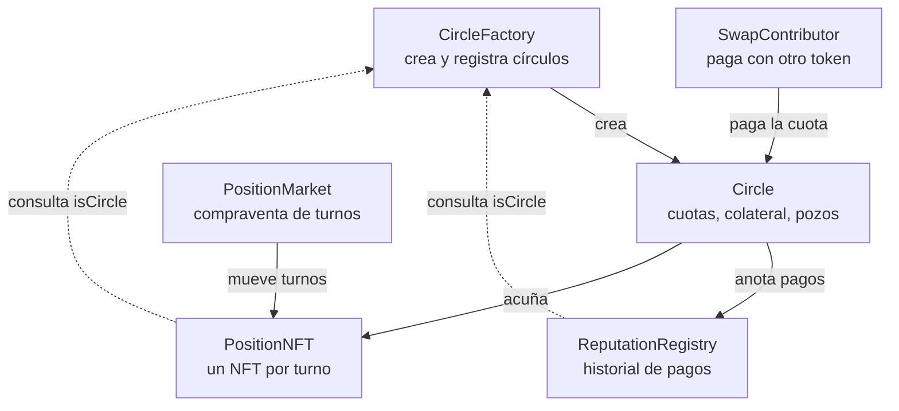

# ROSCA: guía técnica del proyecto

13 de octubre de 2026

## 1. Visión general

ROSCA es un protocolo de círculos de ahorro rotativos (tandas, juntas, panderos, chamas, susus) hecho con 6 contratos en Solidity, 35 tests en Foundry y un script de despliegue. El código está en `~/ROSCA` y usa OpenZeppelin 5.7 con el compilador 0.8.35.

Un círculo funciona así:

1. Alguien crea un círculo: stablecoin, cuota por ronda, número de miembros, duración de la ronda y nivel de colateral.
2. Cada miembro elige un turno y bloquea colateral. Recibe un NFT que representa el derecho a cobrar ese turno.
3. En cada ronda todos pagan la cuota y el titular del NFT de esa ronda cobra el pozo, menos la comisión.
4. Si alguien no paga, su cuota sale de su colateral. Lo que el colateral no cubre se descuenta de su propio pozo cuando le toca cobrar.
5. Al terminar, cada miembro recupera su colateral, con rendimiento si el círculo usa un vault.

El ejemplo que se usa en toda la guía es el de los tests: 4 miembros (Ana en el turno 0, Luis en el 1, Marta en el 2 y Pedro en el 3), cuota de 100 USDC, pozo de 400 USDC, comisión del 1 % y colateral al 100 %.

### Contratos

| Contrato | Función | ¿Tiene owner? | ¿Guarda fondos? |
| --- | --- | --- | --- |
| `CircleFactory` | Crea círculos y guarda las listas blancas y la comisión | Sí, en dos pasos | No |
| `Circle` | La lógica de un círculo: unirse, pagar, cerrar ronda, cobrar, impagos | No | Sí: cuotas y colateral |
| `PositionNFT` | Un NFT por turno; quien lo tiene cobra ese pozo | No | No |
| `ReputationRegistry` | Historial de pagos de cada dirección | No | No |
| `PositionMarket` | Compraventa de turnos en stablecoins | Sí, en dos pasos | Solo sus comisiones |
| `SwapContributor` | Pagar la cuota con otro token vía Uniswap V2 | No | No |

Los fondos de los usuarios solo están en `Circle`, y ahí el owner no tiene ningún poder sobre ellos.



La factory crea cada círculo; el NFT y el registro le preguntan si quien los llama es un círculo legítimo. `SwapContributor` y `PositionMarket` son opcionales para el usuario.

### Estados de un círculo

| Estado | Cómo se llega | Qué se puede hacer |
| --- | --- | --- |
| `Open` | Al crearlo | Unirse con `join`; cancelar si vence `joinDeadline` sin llenarse |
| `Active` | Cuando entra el último miembro | Pagar, cerrar rondas, cobrar pozos, vender turnos |
| `Completed` | Al cerrar la última ronda | Cobrar pozos pendientes y retirar colateral |
| `Cancelled` | `cancel()` sobre un círculo `Open` vencido | Retirar colateral |

## 2. Conceptos previos

Cuatro conceptos aparecen en todo el proyecto: colateral, vault, ERC-4626 y Aave.

### Colateral

El colateral es una garantía: fondos que se dejan bloqueados para asegurar que se cumplirá una obligación. Si cumples, lo recuperas; si no, el contrato se cobra de ahí. Es lo mismo que la fianza de un alquiler.

En blockchain es la única forma de confiar, porque no se sabe quién hay detrás de una dirección y no hay juez al que reclamar. En ROSCA sustituye a la confianza personal de una tanda tradicional.

- **Slash (recorte):** quitar parte del colateral a quien no cumplió.
- **Sobrecolateralizado:** el colateral vale más que lo que se arriesga.

### Vault

Un vault es un smart contract que guarda dinero de muchas personas y lleva la cuenta de cuánto corresponde a cada una. Un vault de rendimiento además invierte ese dinero, por ejemplo prestándolo, y reparte las ganancias.

En lugar de guardar saldos fijos, entrega **shares** (participaciones). Si tienes el 10 % de las shares, te corresponde el 10 % de lo que haya en el vault. Cuando el vault gana intereses no hay que actualizar ningún saldo: cada share vale más.

### ERC-4626

ERC-4626 es la forma estándar de programar un vault con shares, igual que ERC-20 lo es para un token. El vault es a la vez un ERC-20: las shares son su propio token.

| Función | Qué hace |
| --- | --- |
| `asset()` | Qué token acepta (por ejemplo, USDC) |
| `totalAssets()` | Cuánto vale todo el vault |
| `deposit(assets, receiver)` | Deposito una cantidad de tokens y recibo shares |
| `mint(shares, receiver)` | Pido una cantidad de shares y pago los tokens que cuesten |
| `withdraw(assets, receiver, owner)` | Retiro una cantidad exacta de tokens |
| `redeem(shares, receiver, owner)` | Canjeo una cantidad de shares por tokens |

El valor de una share es `totalAssets() / totalSupply()`. Ejemplo: Ana deposita 1.000 USDC y recibe 1.000 shares. El vault gana 100 USDC. Ana canjea sus 1.000 shares y recibe 1.100 USDC.

Riesgos que conviene conocer:

- **Ataque de inflación:** el primer depositante manipula el valor de la share para que el siguiente reciba 0 shares. OpenZeppelin 5.x lo neutraliza con shares virtuales.
- **Redondeo:** siempre a favor del vault, por eso un test usa un margen de unas pocas unidades.
- **Pérdidas:** si la estrategia pierde dinero, todos pierden en proporción.
- **Liquidez:** algunos vaults no permiten retirar todo al instante.

### Aave

Aave es el mayor protocolo de préstamos de DeFi: unos depositan y ganan intereses, y otros piden prestado dejando una garantía de más valor. Si la garantía deja de cubrir el préstamo, cualquiera puede liquidarla.

Su relación con ROSCA es doble:

- **Fuente de rendimiento:** el vault de un círculo puede, por dentro, prestar el colateral en Aave.
- **Diferencia de producto:** Aave solo presta a quien ya tiene capital. En ROSCA, quien cobra en los primeros turnos recibe crédito real cuando `collateralBps` es menor que 10000.

Los aTokens de Aave son *rebasing*: el saldo crece solo. ROSCA no admite tokens rebasing directamente; habría que usar un wrapper ERC-4626.

## 3. Circle.sol

`Circle` es el contrato principal: cada instancia es un círculo de ahorro, guarda las cuotas y el colateral y aplica todas las reglas. Tiene 506 líneas; los números de línea citados son los de `src/Circle.sol`.

### Herencia e imports (líneas 1-40)

| Import | Para qué |
| --- | --- |
| `IERC20` + `SafeERC20` | Mover tokens de forma segura; revierte si el token devuelve `false` |
| `IERC4626` | Hablar con el vault de rendimiento |
| `ReentrancyGuard` | El modificador `nonReentrant` |
| `Math` | `Math.min` y `Math.mulDiv` (multiplicar y dividir sin desbordamiento) |
| `ICircleFactory` | Preguntar a la factory quién es el owner y quién cobra las comisiones |
| `ICircle` | Interfaz que usan el NFT y el market para consultar el círculo |

### Tipos (líneas 43-66)

`Status` tiene los cuatro estados: `Open`, `Active`, `Completed` y `Cancelled`.

`Config` agrupa lo que elige el creador del círculo:

| Campo | Significado | Valor en el ejemplo |
| --- | --- | --- |
| `token` | Stablecoin de cuotas y colateral | USDC |
| `contributionAmount` | Cuota por ronda | 100e6 |
| `maxMembers` | Miembros y número de rondas | 4 |
| `roundDuration` | Tiempo mínimo para pagar cada ronda | 30 días |
| `joinDeadline` | Fecha límite para llenarse | ahora + 7 días |
| `collateralBps` | Parte de la exposición cubierta con colateral | 10000 (100 %) |
| `yieldVault` | Vault ERC-4626 opcional | `address(0)` si no hay |

### Constantes e inmutables (líneas 68-83)

Las constantes son `BPS = 10_000`, `MIN_MEMBERS = 2` y `MAX_MEMBERS = 50`. El tope de 50 mantiene acotado el gas de los bucles.

Toda la configuración es `immutable`: `factory`, `positionNFT`, `reputation`, `token`, `yieldVault`, `contributionAmount`, `maxMembers`, `roundDuration`, `joinDeadline`, `collateralBps` y `feeBps`. Esto da dos ventajas:

- **Seguridad:** nadie puede cambiar las reglas a mitad del círculo, ni siquiera el owner.
- **Gas:** se guardan en el bytecode y leerlas es mucho más barato que leer storage.

`feeBps` se copia de la factory al crear el círculo. Si el owner sube la comisión después, este círculo no cambia.

### Variables de estado (líneas 85-113)

| Grupo | Variables | Qué guardan |
| --- | --- | --- |
| Progreso | `status`, `memberCount`, `currentRound`, `paidCount`, `startTime`, `currentDeadline` | En qué punto está el círculo |
| Miembros | `slotMember`, `memberSlotPlusOne`, `slotTokenId`, `hasPaid` | Quién tiene cada turno, qué NFT y quién pagó cada ronda |
| Colateral | `collateralOf`, `totalCollateral`, `debtOf`, `defaulted` | Garantía, deuda no cubierta y si falló alguna vez |
| Pagos | `payoutOf`, `payoutClaimed`, `payoutRecipient`, `roundShortfall`, `claimable`, `accruedFees` | Pozos, faltantes, compensaciones y comisiones |
| Liquidación | `collateralPoolAtSettlement`, `collateralAtSettlement` | Colateral real y nominal al final |

`memberSlotPlusOne` guarda el turno más uno. Un mapping devuelve 0 para una clave inexistente, así que guardar `turno + 1` permite distinguir "turno 0" de "no es miembro".

### Constructor (línea 150)

Valida todo antes de guardar nada: token y cuota distintos de cero, entre 2 y 50 miembros, duración mayor que 0, fecha límite en el futuro y colateral como máximo del 100 %. Si hay vault, comprueba que su `asset()` sea el token del círculo.

`factory = msg.sender`: como siempre lo despliega la factory, nadie puede hacerse pasar por ella.

### requiredCollateral (línea 178)

```solidity
uint256 exposure = contributionAmount * (maxMembers - 1 - slot);
return contributionAmount + (exposure * collateralBps) / BPS;
```

El colateral cubre las cuotas que el miembro seguirá debiendo **después de cobrar**, más una cuota de margen. Quien cobra antes bloquea más.

| Turno | Cobra en la ronda | Cuotas que debe después de cobrar | Colateral al 100 % |
| --- | --- | --- | --- |
| 0 (Ana) | 0 | 3 | 400 USDC |
| 1 (Luis) | 1 | 2 | 300 USDC |
| 2 (Marta) | 2 | 1 | 200 USDC |
| 3 (Pedro) | 3 | 0 | 100 USDC |

Las cuotas anteriores al cobro no necesitan colateral: el propio pozo del miembro sirve de garantía, porque la deuda se le descuenta al cobrar.

### join (línea 185)

Sigue el patrón Checks-Effects-Interactions:

1. **Checks:** el círculo está `Open`, no venció el plazo, el turno existe y está libre, y quien llama no es ya miembro.
2. **Effects:** registra al miembro, su turno y su colateral. Si es el último, pasa a `Active` y fija el primer plazo.
3. **Interactions:** cobra el colateral, lo deposita en el vault si lo hay y acuña el NFT del turno.

El usuario tiene que haber hecho antes `approve` del token al círculo.

### cancel (línea 217)

Si pasó `joinDeadline` y el círculo no se llenó, cualquiera puede cancelarlo. Un círculo `Active` no se puede cancelar.

### contribute y contributeFor (líneas 228-251)

`contribute()` paga la cuota propia. `contributeFor(member)` paga la cuota de otro: el dinero sale de `msg.sender` y se apunta a `member`. La usa `SwapContributor`.

Pagar después del plazo está permitido mientras nadie haya cerrado la ronda, pero queda registrado como pago tardío en la reputación.

### closeRound (línea 253)

Cierra la ronda en curso. Se puede llamar cuando todos pagaron o cuando venció el plazo, y lo puede llamar cualquiera.

1. `_collectDefaults` cobra del colateral las cuotas no pagadas.
2. El pozo es lo pagado más lo cobrado de colaterales.
3. La comisión se acumula en `accruedFees`.
4. `_settleRecipient` descuenta al titular sus deudas y repone su colateral.
5. El resultado queda en `payoutOf[round]`; no se envía.
6. Se abre la ronda siguiente con el plazo `max(plazo anterior, ahora) + roundDuration`.
7. Si era la última ronda, `_settle(Completed)`.

El paso 6 evita un ataque: si una ronda se cierra muy tarde, la siguiente tendría el plazo ya vencido y alguien podría cerrarla al instante marcando a todos como morosos. Con esta fórmula siempre hay una ronda completa para pagar.

El pago no se envía en `closeRound` porque un receptor que no pudiera recibir bloquearía el cierre de la ronda.

### \_collectDefaults (línea 398)

Para cada miembro que no pagó:

- **Si es el titular de esta ronda:** no se le cobra nada; su pozo es una cuota más pequeño.
- **Si no:** se toma la cuota de su colateral. Lo que no alcance se anota en `debtOf[miembro]` y en `roundShortfall[ronda]`.

Lo cobrado del colateral entra al pozo, así que el titular de la ronda cobra completo.

### \_settleRecipient (línea 432)

Impide la estafa clásica de "no pago, cobro mi pozo y desaparezco". Antes de pagar al titular:

1. Se le descuenta su deuda del pozo y ese dinero va a las rondas perjudicadas, mediante `_compensate`.
2. Se repone su colateral hasta `requiredCollateral(turno)`, para cubrir las cuotas que aún debe.

### \_compensate (línea 458)

Reparte el dinero recuperado entre las rondas anteriores que quedaron cortas, de la más antigua a la más reciente. Si el titular de esa ronda no cobró todavía, se suma a su pozo; si ya cobró, se acredita en `claimable`.

### claimPayout (línea 282)

Cobra el pozo de una ronda cerrada. Cobra **quien tenga el NFT**, no quien se unió. Después el NFT se quema.

### withdrawClaimable (línea 301)

Retira las compensaciones acumuladas en `claimable`.

### \_settle y withdrawCollateral (líneas 477 y 315)

`_settle` cierra el círculo. Si hay vault, canjea todas las shares. Guarda dos cifras: el colateral real (`collateralPoolAtSettlement`) y el nominal (`collateralAtSettlement`). Los miembros que nunca fallaron suman un círculo completado.

`withdrawCollateral` reparte a prorrata:

```solidity
uint256 amount = Math.mulDiv(nominal, collateralPoolAtSettlement, collateralAtSettlement);
```

Si el vault ganó un 10 %, Ana recibe 400 × 1.100 / 1.000 = 440 USDC. Sin vault, cada uno recibe exactamente su colateral.

### withdrawFees y rescueERC20 (líneas 332-351)

`withdrawFees` la puede llamar cualquiera; el dinero siempre va al `feeRecipient` de la factory.

`rescueERC20` permite al owner de la factory recuperar tokens enviados por error. No puede tocar el token del círculo ni las shares del vault.

### Consultas (líneas 358-390)

- `isPositionLive(slot)`: el turno se puede vender si el círculo está `Active` o `Completed` y el pozo no se cobró.
- `positionInfo(slot)`: token, pozo bruto, importe a cobrar, descuentos pendientes (`encumbrance`) y fecha estimada de cobro.
- `slotOf(member)`: turno de un miembro.

### Ejemplo con un moroso

Pedro (turno 3, colateral 100) no paga las rondas 0 y 1.

| Ronda | Qué pasa | Pozo neto | Cobra |
| --- | --- | --- | --- |
| 0 | Se toman 100 del colateral de Pedro, que queda en 0 | 396 | Ana |
| 1 | Pedro ya no tiene colateral: deuda de 100 y faltante de 100 en la ronda | 297 | Luis |
| 2 | Todos pagan | 396 | Marta |
| 3 | A Pedro se le descuentan 100 de deuda (van a Luis) y 100 para reponer colateral | 196 | Pedro |

Luis recupera sus 100 con `withdrawClaimable`. Pedro recupera su colateral de 100 al final. El contrato termina con 0 USDC.

## 4. CircleFactory.sol

La factory despliega los círculos, guarda la lista de los que existen y contiene la configuración global. Es la única fuente de verdad sobre qué contratos son círculos legítimos.

### Herencia (línea 21)

Hereda de `Ownable2Step`. La propiedad se transfiere en dos pasos: el owner propone y la nueva dirección acepta con `acceptOwnership()`. Con `Ownable` simple, un error al escribir la dirección supone perder el contrato para siempre.

### Variables

| Variable | Qué guarda |
| --- | --- |
| `MAX_FEE_BPS = 200` | Tope de comisión: 2 % |
| `positionNFT`, `reputation` | Los contratos de NFT y reputación (inmutables) |
| `feeRecipient` | Quién cobra las comisiones |
| `feeBps` | Comisión para los círculos nuevos |
| `isCircle` | Si una dirección es un círculo legítimo |
| `allowedToken`, `allowedVault` | Listas blancas de tokens y vaults |
| `circles` | Lista de todos los círculos |

`isCircle` es el mapping más importante del sistema: `PositionNFT` y `ReputationRegistry` lo consultan para decidir quién puede acuñar NFT y escribir reputación.

### Constructor (línea 51)

El NFT y el registro necesitan la dirección de la factory, y la factory necesita las suyas. Se resuelve porque la dirección de un contrato se puede calcular antes de desplegarlo: depende de quién lo despliega y de su nonce.

1. Se calcula la dirección que tendrá la factory.
2. Se despliegan el NFT y el registro con esa dirección.
3. Se despliega la factory, que comprueba que ambos apuntan a ella. Si no, revierte con `WrongFactory`.

Así todo queda inmutable y no hace falta una función `setFactory()`.

### createCircle (línea 68)

Cualquiera puede crear un círculo. Solo se exige que el token y el vault estén en la lista blanca. La función despliega el contrato con `new Circle(...)`, lo marca en `isCircle` y lo añade a `circles`.

Las listas blancas existen por dos motivos: un token malicioso o con comisión por transferencia rompería la contabilidad, y un vault falso podría quedarse con el colateral.

### Funciones del owner (líneas 88-112)

| Función | Qué hace | Protección |
| --- | --- | --- |
| `setTokenAllowed` | Añade o quita un token | No acepta `address(0)` |
| `setVaultAllowed` | Añade o quita un vault | No acepta `address(0)` |
| `setFeeBps` | Cambia la comisión de los círculos futuros | Máximo 2 % |
| `setFeeRecipient` | Cambia quién cobra | No acepta `address(0)` |

El owner no puede tocar un círculo existente: ni cambiar su comisión, ni pausarlo, ni mover sus fondos.

## 5. PositionNFT.sol

`PositionNFT` representa cada turno de cada círculo como un NFT ERC-721: quien lo tiene cobra ese pozo. Hay un solo contrato para todos los círculos, así el market trabaja con una única colección.

### Estructura (líneas 23-34)

Cada NFT guarda una `Position` con dos datos: el círculo al que pertenece y el turno. Los ID empiezan en 1, de modo que 0 significa "sin posición".

### onlyCircle (línea 42)

```solidity
modifier onlyCircle() {
    if (!factory.isCircle(msg.sender)) revert NotCircle();
    _;
}
```

Solo los círculos registrados en la factory pueden acuñar.

### mint (línea 54)

El círculo la llama desde `join`. El NFT recuerda qué círculo lo creó (`msg.sender`).

Usa `_mint` y no `_safeMint`. `_safeMint` llama a `onERC721Received` si el destinatario es un contrato, y esa llamada externa en mitad de `join` abriría una puerta a la reentrancy.

### burn (línea 62)

Solo el círculo que creó el NFT puede quemarlo; ni el dueño ni otro círculo pueden. Se quema al cobrar el pozo o al cancelarse el círculo.

`positions[tokenId]` no se borra al quemar. Queda como historial y el market lo usa para detectar posiciones ya cobradas.

### tokenURI (línea 70)

Los metadatos se generan dentro del contrato, sin servidor ni IPFS:

1. Pide al círculo los datos actuales del turno con `positionInfo`.
2. Construye un JSON con círculo, turno, pozo bruto, descuentos pendientes y fecha de cobro.
3. Lo codifica en Base64 y lo devuelve como `data:` URI.

Los datos siempre están actualizados: si el titular acumula deuda, el NFT lo refleja.

## 6. ReputationRegistry.sol

`ReputationRegistry` guarda el comportamiento de cada dirección en todos los círculos, como un historial crediticio público. No es un token: no hay `transfer`, así que la reputación no se puede vender ni mover.

### La ficha (línea 13)

| Campo | Qué cuenta |
| --- | --- |
| `onTimePayments` | Pagos a tiempo |
| `latePayments` | Pagos después del plazo |
| `defaults` | Impagos |
| `circlesCompleted` | Círculos terminados sin fallar nunca |
| `outstandingDebt` | Deuda que quedó sin cubrir |

Los cuatro contadores `uint32` caben en un solo slot de storage, así que actualizarlos es barato.

### Funciones (líneas 43-69)

Solo los círculos legítimos pueden escribir, con el mismo modificador `onlyCircle` que el NFT.

| Función | Cuándo la llama `Circle` | Efecto |
| --- | --- | --- |
| `recordPayment(member, onTime)` | En `contributeFor` | Suma un pago a tiempo o tardío |
| `recordDefault(member, uncovered)` | En `_collectDefaults` | Suma un impago y la deuda no cubierta |
| `recordDebtRepaid(member, amount)` | En `_settleRecipient` | Resta la deuda recuperada |
| `recordCompletion(member)` | En `_settle` | Suma un círculo completado |
| `recordOf(member)` | Cualquiera, solo lectura | Devuelve la ficha |

`recordDebtRepaid` nunca revierte por desbordamiento: si se repaga más de lo registrado, la deuda queda en 0. Un fallo en la reputación no debe bloquear el cierre de una ronda.

Hoy el registro solo guarda datos; ningún contrato decide con ellos. El paso siguiente es que `requiredCollateral` pida menos colateral a quien tenga buen historial.

Limitación: alguien con mal historial puede crear una wallet nueva. Por eso la reputación sirve para premiar, no para castigar.

## 7. PositionMarket.sol

`PositionMarket` permite vender y comprar turnos pagando en stablecoins. Ejemplo: Pedro tiene el turno 3 pero necesita dinero ahora, y vende su NFT a Juan por 350 USDC. Juan cobrará 396 USDC en la ronda 3. Pedro sigue obligado a pagar sus cuotas.

### Estructura

Hereda de `Ownable2Step` y `ReentrancyGuard`. La comisión tiene un tope del 5 % (`MAX_FEE_BPS = 500`).

Cada `Listing` guarda el vendedor, el token de pago y el precio. Las comisiones se acumulan por token en `accruedFees`.

### list (línea 86)

Pone un turno en venta tras cinco comprobaciones:

1. El precio es mayor que 0.
2. Quien lista es el dueño del NFT.
3. El market está aprobado para mover el NFT.
4. El token de pago está en la lista blanca de la factory.
5. La posición está viva: el círculo está activo y el turno no se cobró.

El NFT no sale de la wallet del vendedor al listar; solo se transfiere cuando alguien compra.

### buy (línea 113)

El comprador pasa el token y el precio máximo que acepta. La función borra el listado y anota la comisión antes de mover el dinero y el NFT.

| Protección | Qué evita |
| --- | --- |
| `maxPrice` y `paymentToken` como parámetros | Que el vendedor suba el precio o cambie el token justo antes de la compra (front-running) |
| `StaleListing` | Comprar a un vendedor que ya transfirió el NFT |
| `PositionNotLive` | Comprar un turno cuyo pozo ya se cobró |
| Pago en ERC-20 directo al vendedor | Un vendedor que rechaza el pago y bloquea la venta |
| Comisión acumulada y retirada después | Un receptor de comisiones que bloquea todas las ventas |

### cancel (línea 102)

El vendedor siempre puede cancelar. Cualquiera puede limpiar un listado obsoleto, es decir, cuando el vendedor ya no tiene el NFT.

### Funciones auxiliares

- `_isLive` (línea 160): busca el círculo y el turno del NFT y pregunta al círculo si sigue vivo.
- `_ownerOrZero` (línea 165): usa `try/catch` porque `ownerOf` revierte si el NFT fue quemado.
- `withdrawFees`, `setFeeBps`, `setFeeRecipient` y `calculateFee`: gestión de la comisión.

## 8. SwapContributor.sol

`SwapContributor` permite pagar la cuota con un token distinto al del círculo, en una sola transacción. No tiene owner ni estado: el dinero entra y sale en la misma llamada.

### contributeWithSwap (línea 44)

Ejemplo: Ana autoriza hasta 200 DAI y el cambio es 1 USDC = 1,01 DAI.

| Paso | Qué ocurre |
| --- | --- |
| 1 | Se comprueba que el círculo viene de la factory y que la ruta termina en el token del círculo |
| 2 | El contrato toma 200 DAI de Ana y aprueba el router |
| 3 | Uniswap entrega exactamente 100 USDC y consume 101 DAI |
| 4 | La autorización al router se pone a 0 |
| 5 | El contrato paga 100 USDC al círculo a nombre de Ana con `contributeFor` |
| 6 | Se devuelven a Ana los 99 DAI sobrantes |

Decisiones de diseño:

- `swapTokensForExactTokens` pide un importe exacto de salida, porque la cuota es fija.
- `forceApprove` funciona con tokens como USDT, que rechazan cambiar una autorización distinta de 0.
- `amountInMax` protege contra el slippage: si hiciera falta más, la transacción revierte.
- `deadline` hace lo mismo con el tiempo: una transacción que tarda demasiado no se ejecuta.

## 9. Interfaces

Una interfaz describe qué funciones tiene un contrato sin incluir su código. Permite que un contrato llame a otro sin importarlo entero y evita dependencias circulares. Están en `src/interfaces/`.

| Interfaz | Qué expone | Quién la usa |
| --- | --- | --- |
| `ICircleFactory` | `isCircle`, `allowedToken`, `feeRecipient`, `owner` | Los otros cinco contratos |
| `ICircle` | `positionInfo`, `isPositionLive` y el struct `PositionInfo` | `PositionNFT` y `PositionMarket` |
| `IV2Router02` | `swapExactTokensForTokens`, `swapTokensForExactTokens`, `getAmountsIn` | `SwapContributor` |

`getAmountsIn` permite a un frontend calcular cuánto token de entrada hará falta antes de enviar la transacción.

## 10. Tests

El proyecto tiene 35 tests en tres archivos, y los 35 pasan con forge 1.7.1 en WSL. Están en `test/`.

| Archivo | Contenido |
| --- | --- |
| `mocks/Mocks.sol` | Contratos simulados: token, vault y router |
| `BaseTest.sol` | Preparación común que heredan los tres archivos de test |
| `Circle.t.sol` | 23 tests del círculo |
| `PositionMarket.t.sol` | 8 tests del market |
| `SwapContributor.t.sol` | 4 tests del pago con swap |

Los nombres siguen una convención: `test_Algo` comprueba que algo funciona, `test_RevertWhen_Algo` que algo falla cuando debe, y `testFuzz_Algo` se ejecuta muchas veces con valores aleatorios.

### Mocks

Un mock es una versión simplificada de un contrato externo. Permite probar sin depender de una red real ni de un RPC.

| Mock | Simula | Particularidad |
| --- | --- | --- |
| `MockERC20` | USDC o DAI | `mint` público y decimales configurables |
| `MockVault` | Un vault ERC-4626 | Tres líneas: hereda todo de OpenZeppelin |
| `MockV2Router` | Uniswap V2 | Tipo de cambio fijo; respeta `EXPIRED` y `EXCESSIVE_INPUT_AMOUNT` |

### BaseTest

Constantes: cuota `C` de 100 USDC, `N` de 4 miembros, rondas de 30 días, comisión del 1 % y 10.000 USDC iniciales por miembro.

`setUp()` se ejecuta antes de cada test con el estado limpio:

1. Crea el USDC y el vault simulados.
2. Calcula la dirección que tendrá la factory con `vm.computeCreateAddress`. Suma 2 al nonce porque antes se despliegan el NFT y el registro.
3. Despliega NFT, registro y factory, y comprueba que la predicción acertó.
4. El owner añade USDC y el vault a las listas blancas.
5. Crea 4 miembros y les da 10.000 USDC a cada uno.

| Función de ayuda | Qué hace |
| --- | --- |
| `_config` | Construye la configuración estándar del círculo |
| `_createCircle` | Crea un círculo y hace que los 4 miembros aprueben el gasto de USDC |
| `_joinAll` | El miembro `i` se une al turno `i`; el círculo queda `Active` |
| `_payAll` | Los 4 pagan la cuota de la ronda actual |
| `_net` | Resta el 1 % de comisión: `_net(400) = 396` |
| `_assertSolvent` | Comprueba que el círculo tiene al menos lo que debe |

`_assertSolvent` suma todo lo que el círculo debe (comisiones, pozos sin cobrar, compensaciones, cuotas de la ronda en curso y colateral) y exige que su saldo de USDC sea mayor o igual.

Los cheatcodes que más aparecen: `vm.prank(x)` hace que la próxima llamada la haga `x`, `vm.expectRevert(...)` exige que la próxima llamada falle con ese error y `vm.warp(t)` cambia el reloj.

### Circle.t.sol: creación y unión

| Test | Qué comprueba |
| --- | --- |
| `test_RevertWhen_TokenNotAllowed` | No se crea un círculo con un token fuera de la lista blanca |
| `test_RevertWhen_InvalidConfig` | `collateralBps = 10001` revierte |
| `test_RequiredCollateral_DecreasesBySlot` | Los turnos piden 400, 300, 200 y 100; al 50 %, el turno 0 pide 250 |
| `test_Join_MintsPositionsAndStarts` | Con los 4 dentro: estado `Active`, 1.000 de colateral, cada uno con su NFT, plazo a 30 días |
| `test_RevertWhen_SlotTaken` | Dos personas no pueden tomar el mismo turno |
| `test_RevertWhen_AlreadyMember` | Una persona no puede tomar dos turnos |
| `test_RevertWhen_JoinAfterDeadline` | Pasados 7 días no se puede unir nadie |

### Circle.t.sol: camino normal y reglas de ronda

`test_FullCycle_AllPay` recorre las 4 rondas con todos pagando. Comprueba que cada titular cobra 396 USDC, que el círculo termina `Completed` con 0 USDC, que la tesorería recibe 16 USDC y que cada miembro acaba con 10.000 menos 4 USDC. La reputación de cada uno queda en 4 pagos a tiempo y 1 círculo completado.

| Test | Qué comprueba |
| --- | --- |
| `test_RevertWhen_CloseBeforeDeadline` | Con un solo pago y el plazo vigente no se puede cerrar; tras el plazo, sí |
| `test_RevertWhen_ContributeTwice` | No se paga dos veces la misma ronda |
| `test_RevertWhen_ClaimTwiceOrOpenRound` | No se cobra una ronda abierta ni dos veces la misma |
| `test_LateClose_GivesFullWindowToNextRound` | Si la ronda 0 se cierra 100 días tarde, la ronda 1 tiene 30 días completos |

### Circle.t.sol: impagos

| Test | Qué comprueba |
| --- | --- |
| `test_Default_CollateralKeepsPotWhole` | Pedro no paga la ronda 0: el pozo sigue en 396, su colateral baja a 0 y suma un impago |
| `test_Default_DebtWithheldFromOwnPayoutAndCompensated` | El escenario del moroso de la sección 3: Pedro cobra 196, Luis recibe 100 de compensación y el círculo termina en 0 |
| `testFuzz_Conservation` | 512 ejecuciones con pagos y colateral aleatorios |

`testFuzz_Conservation` recibe un `seed` y un `collateralBps` aleatorios. Cada miembro paga cada ronda con un 75 % de probabilidad. En cada ejecución verifica tres cosas:

- **Solvencia** después de cada ronda, con `_assertSolvent`.
- **Nada bloqueado:** al final el círculo tiene 0 USDC.
- **Conservación:** los 4 miembros y la tesorería suman exactamente 40.000 USDC.

### Circle.t.sol: posiciones, cancelación, rendimiento y administración

| Test | Qué comprueba |
| --- | --- |
| `test_TransferredPosition_MovesPayoutRight` | Si Ana transfiere su NFT, ya no puede cobrar; cobra el nuevo titular y el NFT se quema |
| `test_TokenURI_IsOnChainJson` | El `tokenURI` empieza por `data:application/json;base64,` |
| `test_RevertWhen_NonCircleMints` | Quien no es un círculo no puede acuñar |
| `test_Cancel_ReturnsCollateralAndBurnsPositions` | Con 2 de 4 miembros y el plazo vencido: se cancela, ambos recuperan 10.000 USDC y los NFT se queman |
| `test_RevertWhen_CancelActiveCircle` | Un círculo que ya empezó no se puede cancelar |
| `test_YieldVault_SharesYieldProRata` | El colateral está en el vault; con un 10 % de rendimiento cada uno recibe su colateral por 1,10 |
| `test_RescueERC20_CannotTouchMembersFunds` | El owner no puede rescatar USDC, pero sí un token ajeno |
| `test_FeeIsSnapshottedAtCreation` | Subir la comisión no afecta a un círculo ya creado; no se puede pasar del 2 % |

### PositionMarket.t.sol

El `setUp` despliega el market con una comisión del 2,5 %, crea un círculo activo, da 1.000 USDC a un comprador y hace que Pedro apruebe el market.

| Test | Qué comprueba |
| --- | --- |
| `test_ListAndBuy` | Venta por 350 USDC: Pedro recibe 341,25, el market acumula 8,75 y la tesorería los retira |
| `test_RevertWhen_ListingIsStale` | Si el vendedor transfirió el NFT, la compra revierte y cualquiera limpia el listado |
| `test_RevertWhen_SellerRaisesPriceBeforeBuy` | Subir el precio a 700 hace fallar una compra con `maxPrice` de 350 |
| `test_RevertWhen_ListWithoutApproval` | Sin aprobar el market no se puede listar |
| `test_RevertWhen_NotOwnerLists` | No se lista un NFT ajeno |
| `test_RevertWhen_PositionAlreadyClaimed` | No se compra un turno cuyo pozo ya se cobró |
| `test_RevertWhen_PositionOfOpenCircle` | No se lista el turno de un círculo que no arrancó |
| `test_RevertWhen_FeeAboveCap` | La comisión no puede superar el 5 % |

### SwapContributor.t.sol

El `setUp` crea DAI y un router con el cambio 1 USDC = 1,01 DAI.

| Test | Qué comprueba |
| --- | --- |
| `test_ContributeWithSwap_RefundsLeftover` | Con 200 DAI autorizados se gastan 101, la cuota queda pagada, se devuelven 99 y no queda saldo ni autorización en el contrato |
| `test_RevertWhen_PathDoesNotEndInCircleToken` | Una ruta que no termina en USDC revierte |
| `test_RevertWhen_UnknownCircle` | Un círculo que no viene de la factory es rechazado |
| `test_RevertWhen_SlippageTooHigh` | Con 100 DAI autorizados y 101 necesarios, revierte |

### Lo que los tests no cubren todavía

| Hueco | Por qué importa |
| --- | --- |
| Vault con pérdidas o sin liquidez | `closeRound` podría revertir |
| Pago tardío | No se comprueba que la reputación registre `latePayments` |
| `contributeFor` llamada por un tercero | Solo se prueba a través de `SwapContributor` |
| Círculos de 2 y de 50 miembros | Los límites y el gas del caso máximo |
| Acceso directo a `ReputationRegistry` | Solo se prueba el control de acceso del NFT, con un `expectRevert` genérico |
| El vendedor cancela su propio listado | Solo se prueba la limpieza por un tercero |
| Transferencia de propiedad en dos pasos | No hay test de `Ownable2Step` |
| Tests de invariantes con handler | El fuzz actual sigue un guion fijo |
| Fork de una red real | No se prueba con el USDC y el Uniswap reales |

### Comandos

```bash
forge test
forge test --match-test test_FullCycle_AllPay -vvvv
forge test --match-contract PositionMarketTest -vv
forge coverage
forge test --gas-report
```

## 11. Script de despliegue

`script/Deploy.s.sol` despliega los cinco contratos del protocolo en el orden correcto. Se ejecutó con éxito contra un nodo local Anvil (chain id 31337): desplegó los cinco contratos y la factory quedó en la dirección prevista. Todavía no se ha desplegado en ninguna red pública.

### Gas del despliegue en Anvil

| Contrato | Gas usado |
| --- | --- |
| `PositionNFT` | 1.545.635 |
| `ReputationRegistry` | 527.099 |
| `CircleFactory` | 3.795.695 |
| `PositionMarket` | 1.232.151 |
| `SwapContributor` | 671.524 |
| **Total** | **7.772.104** |

### Variables de entorno

| Variable | Obligatoria | Qué es |
| --- | --- | --- |
| `OWNER` | Sí | Quién administrará la factory y el market; en producción, un multisig |
| `TREASURY` | Sí | Quién recibe las comisiones |
| `V2_ROUTER` | Sí | Router Uniswap V2 de esa red |
| `FEE_BPS` | No | Comisión de los círculos; por defecto 50 (0,5 %) |
| `MARKET_FEE_BPS` | No | Comisión del market; por defecto 250 (2,5 %) |

### Pasos de run()

1. Lee la configuración con `vm.envAddress` y `vm.envOr`, que devuelve el valor por defecto si la variable no existe.
2. `vm.startBroadcast()` empieza a enviar transacciones reales. `vm.readCallers()` devuelve la cuenta que firma.
3. Calcula la dirección de la factory con el nonce actual más 2.
4. Despliega `PositionNFT` y `ReputationRegistry` con esa dirección, y después `CircleFactory`.
5. Un `require` comprueba que la factory quedó en la dirección prevista. Si no, todo el despliegue revierte.
6. Despliega `PositionMarket` y `SwapContributor`, que necesitan la dirección real de la factory.
7. Imprime las cinco direcciones.

Quien despliega no se queda con ningún poder: el owner es la dirección `OWNER`.

### Cómo usarlo

Primero se guarda la clave cifrada en el keystore de Foundry, una sola vez:

```bash
cast wallet import deployer --interactive
```

Después se ejecuta el script. Sin `--broadcast`, Foundry simula sin enviar nada; conviene hacerlo así primero.

```bash
forge script script/Deploy.s.sol --rpc-url $RPC_URL --account deployer --broadcast --verify
```

Tras el despliegue, el `OWNER` tiene que llamar a `factory.setTokenAllowed(USDC, true)`. Sin eso nadie puede crear círculos. La clave privada nunca debe guardarse en un archivo `.env`.

## 12. Código reutilizado, seguridad y pendientes

El proyecto adapta código de siete repositorios anteriores, que no se modificaron, y corrige los fallos encontrados en ellos. No tiene auditoría externa.

### Qué se reutilizó y qué se corrigió

| Repositorio | Dónde se usa | Reutilizado | Corregido |
| --- | --- | --- | --- |
| Cryptobank | Colateral en `Circle` | Saldos por usuario, retiros con CEI, límite por usuario | Pasa de ETH a ERC-20 con `SafeERC20`; todos los setters emiten evento |
| NFT-Collection | `PositionNFT` | `ERC721`, `Strings`, `_requireOwned` en `tokenURI` | El mint público e ilimitado queda restringido a los círculos; `_mint` en vez de `_safeMint` |
| NFTMarketplace | `PositionMarket` | Flujo listar, comprar y cancelar; `nonReentrant`; comisión en bps con tope | Pagos en ERC-20, comisiones retiradas aparte, listados obsoletos, `maxPrice` contra front-running |
| Presale | `CircleFactory` y `Circle` | Lista de tokens aceptados, ventanas de tiempo, retiro de emergencia | `rescueERC20` no puede tocar fondos de usuarios; los plazos se recalculan en cada ronda |
| Staking-App | Colateral y rendimiento | Bloqueo de un monto fijo, idea de recompensas | El rendimiento se reparte a prorrata al final; no se pierden periodos |
| Swapping-App y SwapLiquiPools | `SwapContributor` | Traer el token, aprobar el router, hacer el swap | Importe exacto con devolución del sobrante, `forceApprove`, ruta validada |

De Presale no se reutilizó el oráculo de Chainlink, porque el círculo trabaja con una sola stablecoin. De SwapLiquiPools se descartó `removeLiquidity`, que permitía a cualquiera robar los LP tokens enviados al contrato.

### Protecciones

| Riesgo | Protección | Dónde |
| --- | --- | --- |
| Reentrancy | `nonReentrant` y patrón CEI | Todas las funciones que mueven dinero |
| El owner se lleva los fondos | `rescueERC20` excluye el token y el vault | `Circle`, línea 343 |
| Cambio de reglas a mitad del círculo | Configuración inmutable y comisión fija | `Circle`, líneas 72-83 |
| Cobrar y desaparecer | Colateral por turno y deuda retenida del pozo | `Circle`, líneas 178 y 432 |
| Cierre de rondas en cadena | El plazo siempre deja la duración completa | `Circle`, línea 253 |
| Un receptor que bloquea pagos | Todos los cobros son retiros iniciados por quien cobra | `claimPayout`, `withdraw*` |
| Bucles sin gas | Máximo de 50 miembros | `Circle`, línea 70 |
| Pérdida de la propiedad | `Ownable2Step` | Factory y market |

Con `collateralBps` en 10000 el círculo es solvente por diseño. Con un valor menor depende en parte de la confianza entre miembros, y un impago no cubierto se reparte entre todos.

### Pendiente antes de mainnet

- [ ] Auditoría externa.
- [ ] Pasar Slither y Aderyn.
- [x] Ejecutar el script de despliegue en un nodo local (Anvil).
- [ ] Desplegar en una testnet pública.
- [ ] Escribir los tests de la tabla de huecos de la sección 10.
- [ ] Decidir qué hacer si el vault pierde valor o liquidez y `closeRound` revierte.
- [ ] Sorteo de turnos con Chainlink VRF o subasta; hoy elige primero quien llega primero.
- [ ] Usar la reputación para reducir el colateral de quien tiene buen historial.
- [ ] Revisar la regulación aplicable antes de ofrecer rendimiento o crédito en la UE.

Limitaciones conocidas: no se admiten tokens con comisión por transferencia ni tokens rebasing, y la deuda que un miembro deja después de cobrar solo queda registrada en su reputación.
